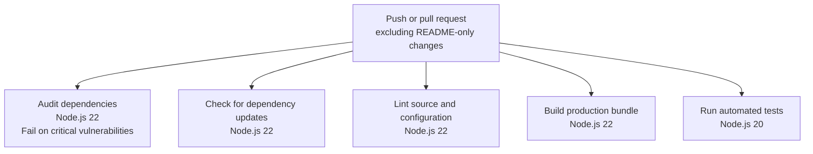

# Vanilla JavaScript SPA

A small single-page application (SPA) built with vanilla JavaScript, HTML, and Sass. It demonstrates client-side hash routing, rendering views without full-page navigation, and loading data from an external API.

## What the application does

- The home route (`#/`) displays a home view with a button that shows a browser alert when clicked.
- The posts route (`#/posts`) fetches posts from [JSONPlaceholder](https://jsonplaceholder.typicode.com/posts) and displays the total and post content. This page requires an internet connection.
- Any unrecognized hash route displays a not-found view.
- Bootstrap and Sass provide the styling. Webpack bundles the application for development and production.

## Requirements

- Node.js 18 or newer for the built-in test runner. The CI test job uses Node.js 20; other CI jobs use Node.js 22.
- npm (included with Node.js).

## Install

From the repository root, install the dependencies:

```shell
npm ci
```

## Run the application

Start the development server:

```shell
npm start
```

Open <http://localhost:8080>. Use the app's links or change the URL hash to navigate, for example `http://localhost:8080/#/posts`.

To use a different port, set the `PORT` environment variable before starting the server.

## npm scripts

| Command | Description |
| --- | --- |
| `npm start` | Starts the Webpack development server at `http://localhost:8080` (or the port set by `PORT`). |
| `npm run build` | Removes the existing `dist` directory, then creates an optimized production bundle in `dist`. |
| `npm run clean` | Removes the generated `dist` directory. |
| `npm run lint` | Runs ESLint on the application source, Webpack configuration, tests, and scripts. |
| `npm test` | Runs the tests with Node.js's built-in test runner. A pretest check requires Node.js 18 or newer. The repository currently includes an intentionally failing test (`tests/intentional-failure.test.mjs`) for CI testing, so this command is expected to fail until that test is removed or changed. |
| `npm run audit` | Checks installed dependencies for known security vulnerabilities. |
| `npm run audit:fix` | Runs `npm audit fix` to apply compatible dependency updates where available. Review the changes and rerun the tests and build afterward. |
| `npm run check:updates` | Uses npm-check-updates (`ncu`) to report newer package versions without changing files. |
| `npm run update:packages` | Uses `ncu -u` to update dependency version ranges in `package.json`. It does not install those versions or refresh the lockfile. Run `npm install` afterward, then rerun the tests and build. |

For example, run the main checks with:

```shell
npm run lint
npm test
npm run build
```

## CI workflow

The GitHub Actions CI workflow runs on pushes and pull requests that include changes other than `README.md`. Each job runs independently and can execute in parallel:



## Security analysis

GitHub Actions runs CodeQL analysis for JavaScript/TypeScript on pushes, pull requests, and weekly. Findings are published in the repository's **Security** tab under **Code scanning**.
